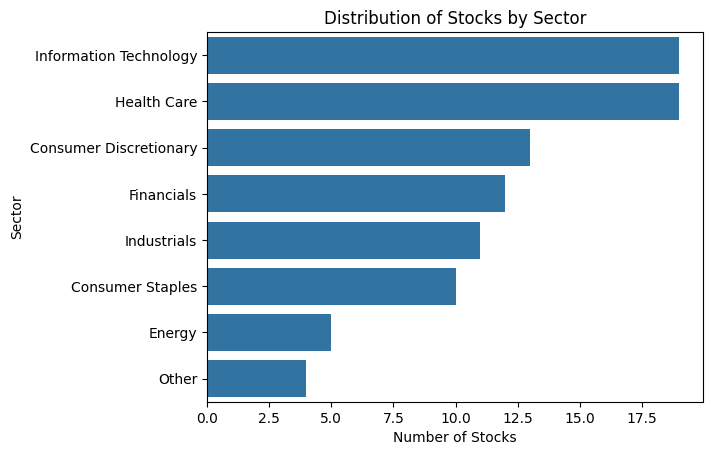
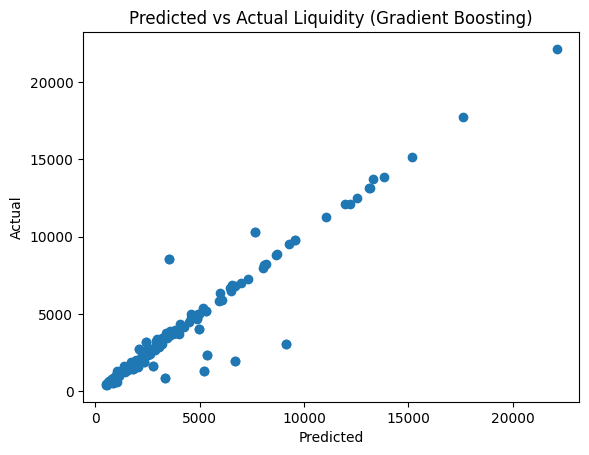

# Corporate Liquidity Prediction & Financial Market Analytics

[](https://www.python.org/)
[](https://scikit-learn.org/)
[](https://pandas.pydata.org/)
[](https://opensource.org/licenses/MIT)

An end-to-end applied financial data science and machine learning repository designed to clean, analyse, and predict corporate liquidity profiles and evaluate equity market fundamentals.

---

## 📌 Executive Summary

Maintaining adequate available liquidity is a core mandate in corporate treasury and risk management. This project develops a systematic quantitative workflow consisting of two core stages:
1. **Equity Fundamental Data Cleaning & Exploratory Analysis (EDA)**: Standardizing categorical labels across market sectors, addressing missing financial metrics, filtering extreme valuation outliers and visualizing risk-return profiles.
2. **Supervised Liquidity Regression Engine**: Benchmarking regularized linear models (Lasso, Ridge, ElasticNet) against ensemble tree models (Random Forest, Gradient Boosting) using robust cross-validation (`GridSearchCV`) to predict corporate `available_liquidity` based on balance sheet and cash flow drivers.

---

## 💼 Skills Demonstrated
* **Financial Data Engineering**: Outlier management, distribution transformation, and sector classification cleanup.
* **Supervised Machine Learning**: Model benchmarking across regularized linear models and tree-based ensembles.
* **MLOps Best Practices**: Leak-free pipelines (`make_pipeline`), k-fold cross-validation (`GridSearchCV`), and unseen client test-set inference.
* **Data Visualization**: Statistical storytelling using Seaborn and Matplotlib diagnostics.

---

## 📊 Exploratory Data Analysis & Preprocessing

### 1. Categorical Normalization & Handling Missing Values
In the equity dataset (`stock_data_v2.csv`), sector naming inconsistencies and dirty strings were mapped to standardized Global Industry Classification Standard (GICS) categories:
* Merged typographical errors (`Information Technology .` $\rightarrow$ `Information Technology`, `Enersy` $\rightarrow$ `Energy`, `Industrial$` / `lndustrials` $\rightarrow$ `Industrials`, `Materials` $\rightarrow$ `Industrials`).
* Aggregated low-sample sectors (`Telecommunication Services`, `Utilities`, `Real Estate`) into an `Other` classification.
* Filtered out unrated/index equity records (e.g., ETFs like SPY, VOO without analyst price targets).

<p align="center">
  
</p>

### 2. Outlier Analysis & Filtering
* Identified extreme price distortions (e.g., `BRK/A` trading at \$324,999/share and tech giants trading >\$1,000/share) to evaluate distribution skewness before financial ratios and return calculations.

---

## 🧠 Machine Learning: Liquidity Regressor

### Feature Schema & Target
The target variable is **`available_liquidity`** (in \$ millions). Predictive features include:
* **`sp_score`**: Standard & Poor's credit health scoring metric.
* **`market_cap`**: Market capitalization.
* **`total_debt`**: Total debt load.
* **`ltm_capex`**: Last twelve months capital expenditure.
* **`ltm_ebitda`**: Last twelve months EBITDA.
* **`ltm_fcf`**: Last twleve months free cash flow.
* **`ltm_revenue`**: Last twelve months revenue.

### Modeling Pipeline
Every algorithm was wrapped inside a standardized `scikit-learn` pipeline with `StandardScaler` to prevent data leakage and ensure scale-invariant optimization:

```
[ Input Features ] ---> [ StandardScaler() ] ---> [ Model Estimator ] ---> [ GridSearchCV (cv=5) ]
```

### Benchmark Results (Test Set: 20%)

| Model | Hyperparameter Search Space | Best Metric ($R^2$) | Test MAE ($M) |
| :--- | :--- | :---: | :---: |
| **Lasso Regression** | $\alpha \in [0.01, 0.05, 0.1, 0.5, 1, 5]$ | 0.498 | $1,710.08 |
| **Ridge Regression** | $\alpha \in [0.01, 0.05, 0.1, 0.5, 1, 5]$ | 0.500 | $1,708.06 |
| **ElasticNet** | $\alpha \in [0.01, 0.05, 0.1, 0.5, 1, 5], \text{ l1\\_ratio} \in [0.1, 0.3, 0.5, 0.7, 0.9]$ | 0.501 | $1,706.04 |
| **Random Forest** | `n_estimators`: [100, 200], `max_features`: [None, 0.3, 0.6] | **0.85** | $933.06 |
| **Gradient Boosting** | `n_estimators`: [100, 200], `lr`: [0.05, 0.1, 0.2], `max_depth`: [1, 3, 5] | 0.886 | **$513.43** |

* **Key Takeaway**: Non-linear tree ensemble architectures dramatically outperformed regularized linear methods. **Gradient Boosting produced the highest variance explained ($R^2 = 88.6\%$) achieved the lowest Mean Absolute Error (\$613.55M)**, making it the most reliable model for risk mitigation and capital allocation decisions.

---

## 📈 Diagnostic Evaluation

<p align="center">
  
</p>

### Client Scenario Inference
Using the optimized Gradient Boosting model on the unseen client scenario (`liquidity_client.csv`), the pipeline yields:
* **Estimated Available Liquidity**: **$28,673.37**

---

## 🚀 Installation & Usage

### 1. Clone the Repository
```bash
git clone https://github.com/fintech-rohan/treasury-liquidity-regressor.git
cd treasury-liquidity-regressor
```

### 2. Set Up Virtual Environment
```bash
python -m venv venv
source venv/bin/activate  # On Windows: venv\Scripts\activate
pip install -r requirements.txt
```

### 3. Dependencies (`requirements.txt`)
```text
numpy>=1.23.0
pandas>=1.5.0
matplotlib>=3.6.0
seaborn>=0.12.0
scikit-learn>=1.2.0
jupyterlab>=3.5.0
```

### 4. Running the Notebooks
Launch JupyterLab and execute the pipelines step-by-step:
```bash
jupyter lab
```
